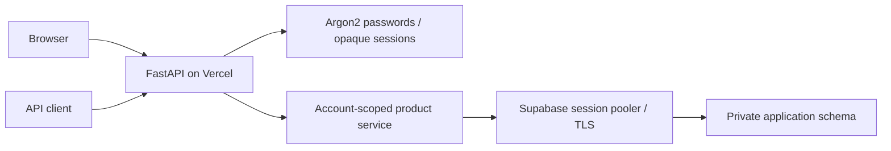

# QQ Pocket: architecture and tradeoffs

## Separation of concerns

`accounts.py` owns identity, session digests, key revocation, origin checks and rate limiting. `product.py` owns domain transactions and route authorization. `app.py` composes both and retains the original engineering-lab endpoints behind the operator API key or bounded public lab actions. `assets/accounts.js` owns login and API-key UI; each application's `assets/application.js` and theme implements its domain workflow.

## Identity and isolation

Every private product query is constrained by the authenticated account ID. Clients cannot choose an owner ID. Ownership is checked before mutating or returning details. Device writes and public checkout links are explicit capability boundaries, not a way to list another account's records. Browser mutations check the Origin header; cross-origin requests are rejected. API clients use a bearer key. Tokens contain 256 bits of random entropy and only their hashes are stored. Passwords use the Argon2 implementation provided by pwdlib.

Accounts are scoped to the application schema; a Pocket account is not a Pay or Kashmir account. Schemas are revoked from Supabase's anonymous and authenticated API roles. The services currently share a database owner connection, so schema separation is not a defense against a compromised service credential. Separate least-privilege database roles are planned.

### Queue guarantees

Submission commits before execution. A background task provides low-latency execution, while Supabase Cron invokes the protected dispatcher every minute when eligible jobs exist. The scheduler runs independently of browsers and local computers. A bounded tick processes up to 20 jobs; additional work drains on later ticks. An API worker can also claim work with a tenant API key.

Claims use PostgreSQL `FOR UPDATE SKIP LOCKED`, a 30-second lease, and an opaque token. Acknowledgement requires the current token and an unexpired lease. Three attempts are allowed; failures back off exponentially and become dead-letter jobs. A crashed worker's lease can be reclaimed. Delivery is **at least once**, not exactly once. External handlers must make their side effects idempotent.

Only four bounded built-in handlers are hosted. Arbitrary Python execution, arbitrary HTTP callbacks, and long-running jobs are not supported. Delay is up to 24 hours; the workspace holds at most 1,000 jobs. The current hosted dispatcher prioritizes oldest eligible jobs across accounts; per-tenant fairness is future work.

## Feasible scaling path

The present design deliberately starts with one managed database and stateless API instances. Database transactions own correctness; adding API replicas does not provide unlimited database capacity. SQLAlchemy NullPool avoids per-instance idle pools, while Supabase session pooling manages backend connections. Indexed owner and readiness lookups keep the current bounded queries predictable.

Before larger traffic: measure p50/p95 latency, lock wait time, connection utilization and write amplification; set workload budgets; add operational dashboards and alerts; move schema changes into a dedicated migration job; and exercise restore/failure drills. Do not claim request-per-second capacity without a reproducible benchmark.
